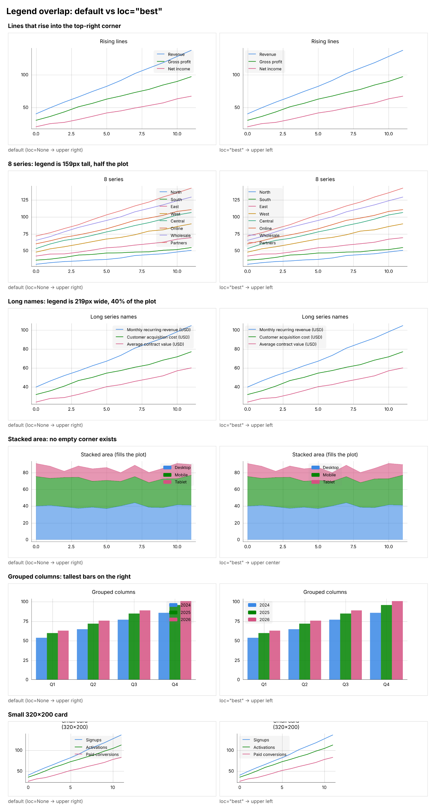

# Legend overlap reproduction

Six typical dashboard charts (the shapes the builder generates) where the
legend covers the data. Each is rendered with the default legend (`loc=None`,
fixed `upper right`) and with `loc="best"` (content-aware placement, #496).



## Findings

- The Cartesian legend is always drawn inside the plot; no location reserves
  space beside it (`js/src/50_chartview.ts`, the note above
  `POLAR_LEGEND_ROOM_FRACTION`).
- The default is a fixed `upper right`, exactly where rising lines and the
  tallest late bars end (cases 1, 3, 5, 6).
- `loc="best"` fixes those, but cannot help when no empty corner exists:
  stacked/filled areas (case 4) and many series (case 2, a 159 px legend).
- Legend size follows label length while the plot does not shrink (case 3:
  219 px wide on a 520 px chart; case 6: a 320x200 card).
- Separate bug: the 320x200 card's wrapped title is clipped at the top.

## Reproduce

From the repo root, after building the core and the JS bundles:

```bash
uv run python examples/legend_overlap/make_cases.py   # writes html/ (git-ignored)
node examples/legend_overlap/shoot.js                 # writes png/ + report.json
```

`report.json` records each legend's resolved location and size. Rebuild
`contact_sheet.png` by screenshotting `sheet.html`.
