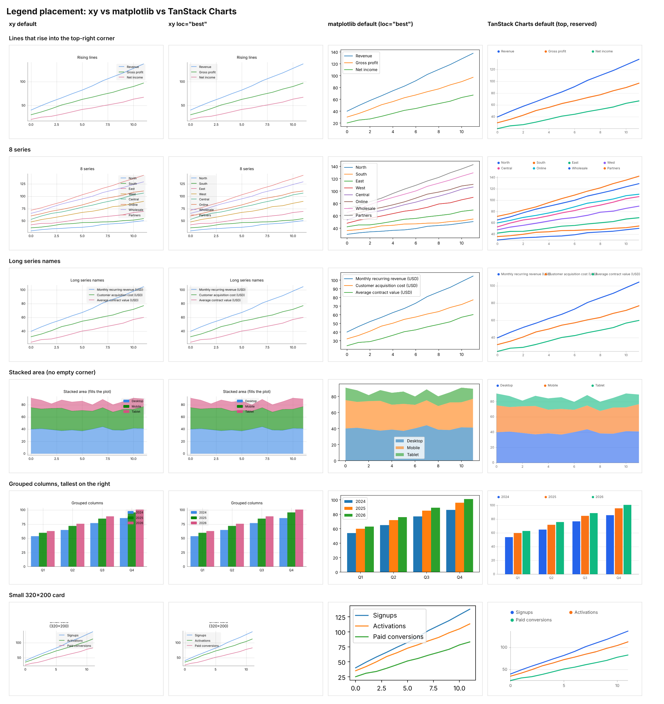

# Legend overlap reproduction

Six typical dashboard charts (the shapes the builder generates) where the
legend covers the data. Each is rendered with the default legend (`loc=None`,
fixed `upper right`) and with `loc="best"` (content-aware placement, #496).


## Findings

- The Cartesian legend is always drawn inside the plot; no location reserves
  space beside it (`js/src/50_chartview.ts`, the note above
  `POLAR_LEGEND_ROOM_FRACTION`).
- The default is a fixed `upper right`, exactly where rising lines and the
  tallest late bars end (cases 1, 3, 5, 6).
- `loc="best"` fixes those, but cannot help when no empty corner exists:
  stacked/filled areas (case 4) and many series (case 2, a 159 px legend).
- Legend size follows label length while the plot does not shrink (case 3:
  219 px wide on a 520 px chart; case 6: a 320x200 card).
- Separate bug: the 320x200 card's wrapped title is clipped at the top.

## Reproduce

From the repo root, after building the core and the JS bundles:

```bash
uv run python examples/legend_overlap/make_cases.py   # writes html/ (git-ignored)
node examples/legend_overlap/shoot.js                 # writes png/ + report.json
```

`report.json` records each legend's resolved location and size. Rebuild
`contact_sheet.png` by screenshotting `sheet.html`.

## Compared with matplotlib and TanStack Charts



Same data in every column (`compare/data.json`, dumped by
`compare/dump_data.py`). Matplotlib 3.11.1 uses its default `ax.legend()`
(`loc="best"`) with `layout="constrained"`. `@tanstack/charts` 1.2.1 uses its
default `colorLegend()`, and its SVG comes from the DOM-free `renderChartSvg`.

- **TanStack Charts never draws the legend over the plot.** Its
  `ChartLegendPlacement` is only `'top' | 'bottom'`, and the legend reserves
  its own layout height, so the plot shrinks instead. All six cases are clean,
  including stacked areas and 8 series (which wrap to a second row).
- **matplotlib's `"best"` fails the same way xy's `"best"` does.** It covers
  data on the 8-series, stacked-area and small-card charts, because every
  in-plot position overlaps something.
- TanStack's one weak spot: with long names, the equal-width legend columns
  let labels run into each other. That is with the DOM-free renderer's text
  estimate; its docs say `colorLegendItems({ justify: "start" })` wraps labels
  using the host's text measurer when mounted in a browser.

Reproduce (TanStack needs `npm install @tanstack/charts` in a scratch folder
containing `tanstack_render.mjs` and `data.json`):

```bash
uv run python examples/legend_overlap/compare/dump_data.py examples/legend_overlap/compare/data.json
uv run --with matplotlib python examples/legend_overlap/compare/matplotlib_render.py examples/legend_overlap/compare
node tanstack_render.mjs   # writes svg/; copy into compare/tanstack/
```
